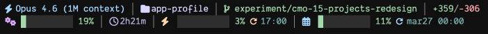

# @cmorenogit/claude-statusline

A rich two-line statusline for [Claude Code](https://docs.anthropic.com/en/docs/claude-code) with themeable semantic color tokens, Nerd Font icons, and block-char progress bars.

## Preview



### Line 1 — Session info

| # | Section | Description |
|---|---------|-------------|
| 1 | Model | Active model display name and reasoning effort (`Opus 5.5 · xhigh`) |
| 2 | Directory | Current project directory |
| 3 | Branch | Git branch (read from `HEAD`, no fork), shortened to fit; `󰙅 wt` in linked worktrees |
| 4 | Lines changed | Lines added / removed in session |

### Line 2 — Metrics & rate limits

| # | Section | Description |
|---|---------|-------------|
| 1 | Context | Context window usage — 10-block bar (each = 10%) plus absolute size (`196k`) |
| 2 | Duration | Time the session has been running (excludes time it was closed); `󰜗 cold` when the prompt cache went cold |
| 3 | Current | 5-hour API usage window with bar and reset time |
| 4 | Weekly | 7-day API usage window with bar and reset time |

## Prerequisites

- **[Claude Code](https://docs.anthropic.com/en/docs/claude-code)** CLI installed and authenticated
- **Bash 4+** — macOS ships with bash 3, install with `brew install bash`
- **[Nerd Font](https://www.nerdfonts.com/)** — required for icons (e.g., JetBrains Mono NF, DankMono NF, MesloLGS NF)
- **jq** — JSON parsing (`brew install jq`)
- **curl** — API usage fallback (pre-installed on macOS); not needed on Claude Code Pro/Max, which sends rate limits on stdin
- **Truecolor terminal** — for theme colors (Ghostty, iTerm2, Kitty, Alacritty, WezTerm)

## Install

```bash
npx @cmorenogit/claude-statusline
```

This will:
1. Detect your bash 4+ path and patch the shebang
2. Back up your existing statusline (if any)
3. Install the script to `~/.claude/statusline-command.sh`
4. Install themes to `~/.claude/statusline-themes/`
5. Update `~/.claude/settings.json` with the statusline config

Restart Claude Code to see the new status line.

## Update

```bash
npx @cmorenogit/claude-statusline@latest
```

## Uninstall

```bash
npx @cmorenogit/claude-statusline --uninstall
```

Restores your previous statusline from backup, removes themes, and cleans the config from settings.

## Themes

Three built-in themes are installed to `~/.claude/statusline-themes/`:

| Theme | Description |
|-------|-------------|
| `catppuccin-mocha` | Warm pastels on dark background (default) |
| `dracula` | High contrast with vibrant accents |
| `nord` | Arctic, cool blue tones |

Switch themes by setting the `STATUSLINE_THEME` environment variable:

```bash
export STATUSLINE_THEME=dracula
```

Add it to your shell profile (`~/.zshrc` or `~/.bashrc`) to persist across sessions. If not set, defaults to `catppuccin-mocha`.

### Semantic color tokens

Themes use semantic tokens instead of color names, so each theme maps meaning to its own palette:

| Token | Used for | Catppuccin Mocha | Dracula | Nord |
|-------|----------|-----------------|---------|------|
| `PRIMARY` | Model, weekly icon | `#89b4fa` | `#8be9fd` | `#88c0d0` |
| `SECONDARY` | Context icon | `#cba6f7` | `#bd93f9` | `#b48ead` |
| `POSITIVE` | Branch, additions, ok bars | `#a6e3a1` | `#50fa7b` | `#a3be8c` |
| `NOTICE` | 5hr rate, moderate bars | `#fab387` | `#ffb86c` | `#d08770` |
| `CAUTION` | Extra credits, warning bars | `#f9e2af` | `#f1fa8c` | `#ebcb8b` |
| `NEGATIVE` | Removals, critical bars | `#f38ba8` | `#ff5555` | `#bf616a` |
| `TEXT` | Directory | `#cdd6f4` | `#f8f8f2` | `#eceff4` |
| `SUBTEXT` | Duration | `#a6adc8` | `#bfbfbf` | `#d8dee9` |
| `OVERLAY` | Reset times | `#7f849c` | `#6272a4` | `#4c566a` |
| `SURFACE` | Separators, empty bars | `#585b70` | `#44475a` | `#3b4252` |

### Usage bar colors

Bars change color dynamically based on utilization percentage:

| Range | Token |
|-------|-------|
| < 50% | `POSITIVE` |
| 50-69% | `NOTICE` |
| 70-89% | `CAUTION` |
| 90%+ | `NEGATIVE` |

### Custom themes

Copy the template and fill in your palette:

```bash
cp themes/_template.sh themes/my-theme.sh
# Edit hex values, install, then activate:
export STATUSLINE_THEME=my-theme
```

## Layouts

Two built-in layouts are installed to `~/.claude/statusline-layouts/`:

| Layout | Lines | Description |
|--------|-------|-------------|
| `full` | 2 | Progress bars, reset times, extra credits (default) |
| `compact` | 1 | Percentages only, no bars or reset times |

Switch layouts by setting the `STATUSLINE_LAYOUT` environment variable:

```bash
export STATUSLINE_LAYOUT=compact
```

### Custom layouts

Copy the template — it documents all available variables, icons, and helper functions:

```bash
cp layouts/_template.sh layouts/my-layout.sh
# Implement render(), install, then activate:
export STATUSLINE_LAYOUT=my-layout
```

## Subagent rows (experimental)

`bin/subagent-statusline.sh` customizes the rows of Claude Code's agent panel through the `subagentStatusLine` setting. It is not installed by `npx` yet. To try it, add to `~/.claude/settings.json`:

```json
"subagentStatusLine": {
  "type": "command",
  "command": "/opt/homebrew/bin/bash \"/path/to/claude-statusline/bin/subagent-statusline.sh\""
}
```

Each row shows the model the subagent runs on, how long it has run, and whether its token count is still growing:

```
general-purpose · opus-5-5 · 6m10s · 84k ↑ · Fix review findings
Explore · haiku-5-5 · low · 2m20s · 51k ⏸ · Search usages
general-purpose · opus-5-5 · ✓ done 12m ago · 35k · Summarize backlog
```

- `↑` the token count grew since the last refresh; `⏸` it hasn't changed in 4 refreshes (~20 s): the subagent may be waiting on something
- Effort appears only when it is set explicitly on the subagent; an inherited effort isn't reported by Claude Code
- Finished rows (`✓ done`, `✗ failed`, `■ killed`) show how long ago they finished, so a row left in the panel is easy to spot
- On any error the script prints nothing and Claude Code keeps its default rows
- `SUBAGENT_SL_LOG=<file>` appends the panel state whenever it changes, for debugging

## How it works

- **Context data** is extracted from the JSON that Claude Code pipes to stdin
- **API rate limits** come from the `rate_limits` field Claude Code pipes to stdin (Pro/Max subscribers), so no token or network call is needed. Without it, the script falls back to `api.anthropic.com/api/oauth/usage` using your OAuth token (Keychain or credentials file), cached for 5 minutes. Set `STATUSLINE_EXTRA_USAGE=1` to force the API path, the only source of extra-usage credits
- **Git branch** is read directly from `HEAD` (no fork), walking up to the repo root and following the `gitdir:` pointer of linked worktrees; a worktree is marked with the `md-file_tree` Nerd Font icon (`󰙅 wt`). Inside a worktree the directory shows the main repo name, and long branch names are shortened to fit the terminal width (`COLUMNS`): the type prefix (`feature/`) goes first, then the middle is cut with `…`, keeping the issue id
- **Session duration** comes from `cost.total_duration_ms` (time the session was running); older Claude Code versions without it fall back to the transcript file birth time
- **No subshells** — helper functions use bash namerefs (`local -n`) to avoid fork overhead
- All JSON parsing is batched into minimal `jq` calls

### Performance

| Scenario | Time |
|----------|------|
| With cache (99% of calls) | ~37ms |
| Cache miss (every 5 min) | ~480ms |

## Platform

macOS only (Apple Silicon & Intel). Requires `brew install bash` for bash 4+.

## License

[MIT](LICENSE)
